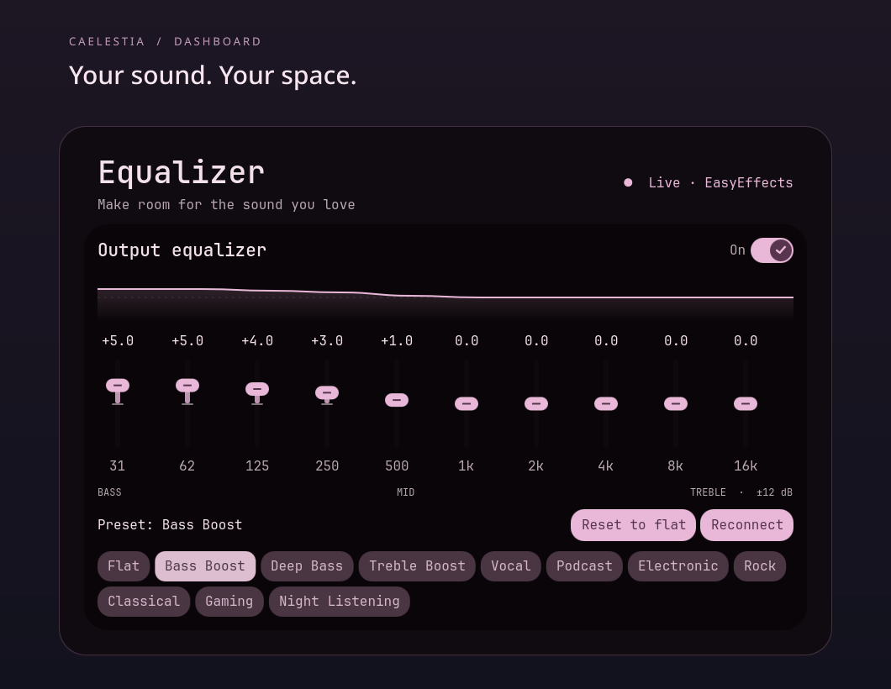
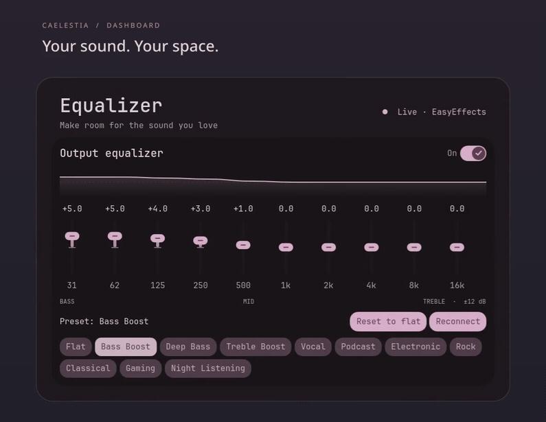
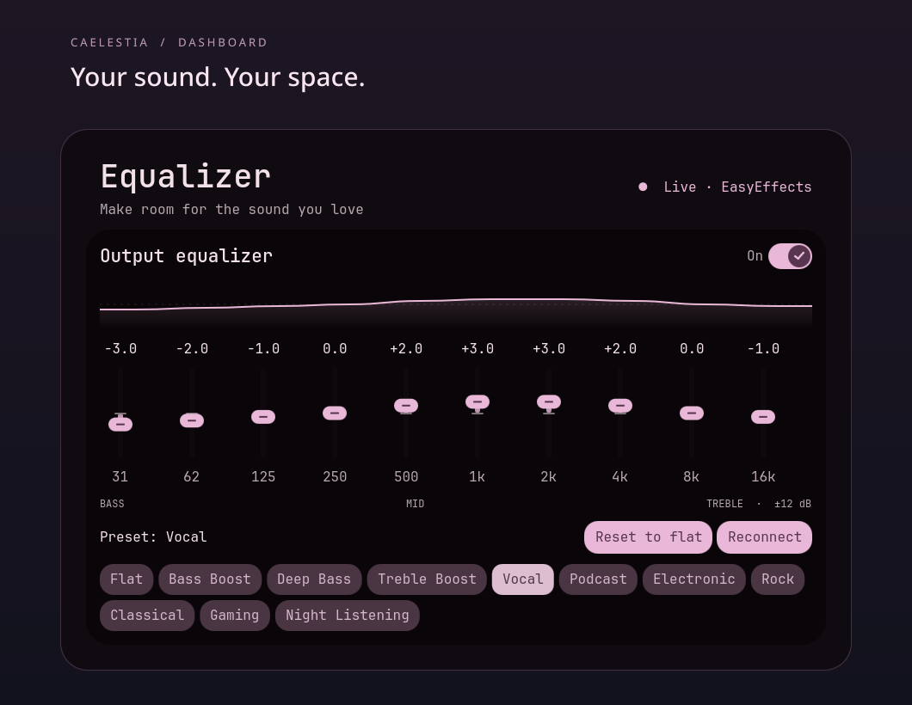
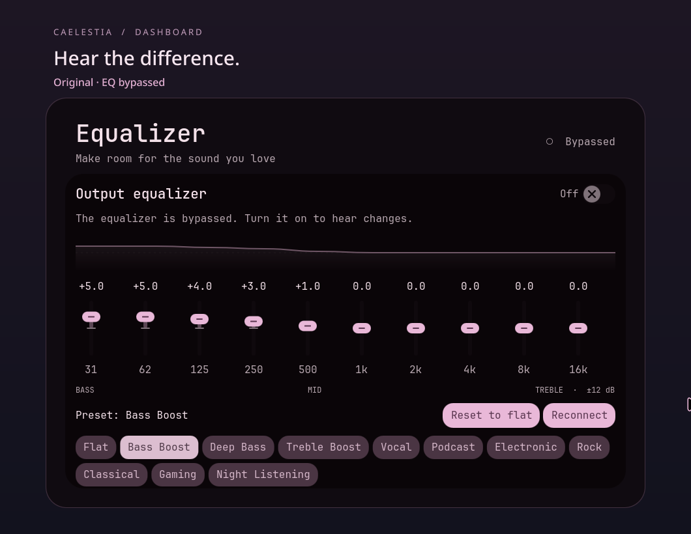

<div align="center">

# Caelestia Equalizer

**Your sound. Your space.**

An animated EasyEffects equalizer, right inside the Caelestia dashboard.

[](LICENSE)
[](#requirements)



[Install](#install) · [Watch the demo](docs/media/demo.mp4) · [Controls](#controls) · [Troubleshooting](#troubleshooting)

</div>

## A little more control over your sound

Change the sound of your music, games, and podcasts without leaving the top dashboard. Choose a preset, shape individual bands, or bypass the equalizer to compare.

- **Smooth motion:** animated faders, gain values, curve transitions, and button feedback.
- **Eleven presets:** Flat, Bass Boost, Deep Bass, Treble Boost, Vocal, Podcast, Electronic, Rock, Classical, Gaming, and Night Listening.
- **Comfortable controls:** drag, scroll, or use your keyboard; reset a focused band with Space.
- **Responsive editing:** changes are grouped and queued while EasyEffects saves, keeping the controls available.
- **Real settings:** reads and verifies values through EasyEffects’ local socket. Reopening the tab shows the current equalizer.
- **Caelestia styling:** follows your shell’s colors, fonts, rounding, and animation tokens.

## Preview



**Sound on: [watch or download the music comparison (MP4)](docs/media/demo.mp4)** · [Browse all previews](docs/media)

The video is a 32-second desktop recording showing the equalizer in the real Caelestia dashboard, with music and preset changes. Turn on sound to hear it. The GIF is a silent preview made from the same recording; the still screenshots show closer views of the controls. The drawn curve visualizes band gains; it is not a measured acoustic response or the exact combined filter response.

<details>
<summary>More screenshots: Vocal and bypass</summary>

### Vocal



### Bypassed



</details>

## Requirements

- An existing **Caelestia Quickshell installation** with the dashboard layout used by [caelestia-dots/shell](https://github.com/caelestia-dots/shell).
- A working **PipeWire desktop audio session**. This add-on does not install or replace Caelestia, your compositor, or your audio server.
- **Arch Linux or CachyOS** for automatic package installation.
- Native **EasyEffects 8.3.0 or newer**, **LSP LV2 plugins**, and **Python 3**. The installer installs missing EasyEffects/LSP packages and bootstraps Python on Arch-based systems.

The installer checks the dashboard before changing it. Older releases or forks with a different dashboard structure may require a small navigation adaptation. Flatpak EasyEffects is not supported by this installer.

Tested locally with EasyEffects **8.3.2**, LSP LV2 **1.2.35**, and the Caelestia dashboard on CachyOS. Other distributions can use `--no-packages` after installing compatible native dependencies; automatic package setup is Arch-specific.

## Install

Run this from a terminal **as your normal desktop user**:

```bash
git clone https://github.com/DevMagician543/caelestia-equalizer.git
cd caelestia-equalizer
./install.sh
```

Or download and extract the installer archive from [Releases](https://github.com/DevMagician543/caelestia-equalizer/releases), open its folder, and run `./install.sh`.

The installer:

1. Checks that the Caelestia dashboard has a supported layout.
2. Installs missing `easyeffects` and `lsp-plugins-lv2` packages using `sudo pacman -S --needed`. It does not perform a system upgrade.
3. Starts EasyEffects in the background and checks its local control socket.
4. Keeps an existing `equalizer#0` and its settings. If it is missing, adds a **flat ten-band output equalizer** while retaining the existing effect chain, input effects, and blocklists.
5. Enables EasyEffects at login through a user systemd service, or XDG autostart if a user systemd session is unavailable.
6. Backs up changed files, installs the dashboard tab and a narrow wrapper change that keeps the selected Equalizer page alive while closed, and reloads Caelestia. If the reload interface is unavailable, it restarts the running shell.

Open the **top dashboard → Equalizer**. Fresh setups begin flat; installing does not automatically apply a bass boost. Existing bypass settings are retained.

A flat **Caelestia Equalizer** output preset is also saved as an optional recovery preset. **Loading that preset manually replaces the output effects chain.** The installer does not load it over your existing effects.

### Options

```bash
./install.sh --no-restart       # Install without reloading Caelestia
./install.sh --no-autostart     # Leave login startup unchanged
./install.sh --no-audio-setup   # Leave the running audio configuration unchanged
./install.sh --no-packages     # Use dependencies you installed yourself
./install.sh --shell-dir ~/.config/quickshell/caelestia
```

Options can be combined. `--no-audio-setup` still allows dependency installation, startup registration, and the optional preset file; combine it with `--no-autostart` when managing EasyEffects yourself. `CAELESTIA_DIR` is also accepted for a custom shell location. XDG configuration and data directories are respected.

## Controls

| Action | Control |
|---|---|
| Adjust a band | Drag its slider |
| Make a small adjustment | Hover and scroll, or focus a slider and use arrow keys |
| Reset one band | Focus its slider and press **Space** |
| Choose a sound | Click a preset |
| Reset every band | **Reset to flat** |
| Compare with the original | Toggle **Output equalizer** |
| Recheck EasyEffects | **Reconnect** |

The normal controls cover **−12 to +12 dB**. Existing equalizers with up to **32 bands** are supported, and presets are interpolated across their frequencies. Both channels receive the same gain adjustments, including when EasyEffects has split channels enabled.

Manual edits show **Custom** until they match a named preset. Named presets are built-in gain curves; they are separate from EasyEffects’ saved full-chain presets.

Positive EQ boosts need input headroom. Use EasyEffects’ own **input gain** control when necessary and watch its meters for clipping. The tab changes band gains and equalizer bypass; it does not automatically manage input gain, output gain, or global bypass.

## Update

```bash
cd caelestia-equalizer
git pull --ff-only
./install.sh
```

Reinstalling is safe: it avoids duplicate tabs and retains an existing equalizer’s tuning. After an upstream Caelestia update, run the installer again if the custom tab disappears.

## Uninstall and backups

```bash
./install.sh --uninstall
```

Removes the tab and its helper and restores the dashboard wrapper’s original loading policy while retaining the rest of the dashboard. It keeps EasyEffects, its audio settings, the optional preset, and startup configuration so your audio continues to work.

Backups are stored under:

```text
<caelestia-directory>/equalizer-installer-backups/<timestamp>/
```

Each run backs up the files it changes. Audio database backups are created only when the installer needs to add the equalizer. Stop EasyEffects before manually restoring its database files, then start it again. Avoid restoring an old `Content.qml` over newer unrelated dashboard changes; use the uninstall command to remove only this tab.

If you also want to disable the user systemd startup, run:

```bash
systemctl --user disable easyeffects.service
```

For XDG autostart installations, remove `~/.config/autostart/com.github.wwmm.easyeffects.desktop` instead. These are optional; uninstalling the tab does not remove them.

## Performance reports

Version 1.0.3 keeps the selected Equalizer page alive when the drawer closes, avoiding rebuilding its controls on every opening. The first visual build is asynchronous; polling pauses while the page is hidden, and settings refresh when it becomes visible again. Other selected tabs keep their original unload behavior. See the [opening check](docs/performance/opening-1.0.3.md) for local measurements and their limits.

Version 1.0.2 sends only edited bands and avoids a redundant full read before each adjustment. A ten-band single-slider edit uses 29 socket requests instead of 88 in the regression test. This is a control-traffic improvement, not an FPS measurement or a confirmed fix for idle lag.

If the dashboard or visualizer becomes slow, report whether it happens only while adjusting the equalizer, with the tab open but idle, or with the dashboard closed. Include your CPU/GPU, EasyEffects and Caelestia versions, band count, and whether EasyEffects was already running before installation. This helps distinguish UI work from the audio processing that the installer starts.

## Troubleshooting

| Message or symptom | What to do |
|---|---|
| EasyEffects is not running | Run `easyeffects --service-mode --hide-window`, then **Reconnect**. For systemd startup, inspect `systemctl --user status easyeffects.service`. |
| Equalizer audio plugin missing | Install `lsp-plugins-lv2`, restart EasyEffects, then reconnect. |
| Audio plugin is not loaded | Restart EasyEffects after installing LSP plugins. |
| No equalizer in the output chain | Run the installer again, or add an output Equalizer in EasyEffects. The tab controls instance `equalizer#0`. |
| Global bypass is on | Turn off global bypass in EasyEffects. |
| Controls change but an app sounds unchanged | Check that the app is routed through EasyEffects and is not blocklisted. |
| Unsupported dashboard layout | Check `--shell-dir`; inspect the layout before adapting it. The installer refuses an unrecognized layout. |
| EasyEffects is too old | Update your distribution’s packages to a compatible version. |
| Changes sound distorted | Lower equalizer input gain in EasyEffects and reduce the boost. |

For direct startup, logs are written to `~/.local/state/caelestia-equalizer/easyeffects.log`. For systemd startup, use `journalctl --user -u easyeffects.service`. Inspect shell errors with `qs -c caelestia log -t 50`.

## Development

```bash
python3 -m unittest discover -s tests -v
python3 -m compileall -q install.py assets/sound tests
bash -n install.sh
qmllint assets/EqualizerTab.qml  # With Caelestia/Qt QML tooling installed
```

Tests cover dashboard patching, idempotency, removal, fresh audio configuration, preservation of existing settings, atomic writes, and installation in an isolated temporary home. The [GitHub Actions workflow](.github/workflows/checks.yml) runs the Python and Bash checks on pushes and pull requests without touching a real audio session.

```text
assets/EqualizerTab.qml       Dashboard UI
assets/sound/easyeffects.py   Local socket client
install.sh                   Installer entry point / Python bootstrap
install.py                   Dependency, audio, startup, and dashboard setup
docs/media/                  Screenshots, GIF, and MP4 demo
tests/                       Installer regression tests
```

## Credits and license

Created by [DevMagician543](https://github.com/DevMagician543).

Built for [Caelestia](https://github.com/caelestia-dots/shell), using its existing components and design tokens. Audio processing is provided by [EasyEffects](https://github.com/wwmm/easyeffects) and [LSP Plugins](https://lsp-plug.in/). This is a community add-on, not an official Caelestia or EasyEffects release.

Licensed under [GPL-3.0](LICENSE). See [NOTICE](NOTICE) for upstream attribution.
